ZUMBALERIO HOSPITAL: Customer Service Queue Management System

This is a console program written in Java that helps keep track of customers and the order they get served in. You can register customers, line them up in a queue, serve them one by one, sort the records, and search for someone when you need to. It's written in a plain procedural style, so there are no custom classes, just static methods and a few collections.

Project Description

Think about a hospital counter, a bank, or any office where people wait in line. It gets messy fast. Someone gets served out of turn, a record goes missing, or the staff can't quickly tell who's next or how long everyone will be waiting.

I made this program to fix those problems in a simple way. Every customer gets a record with an ID, name, concern, estimated service time, and status. A queue then makes sure people are served in the order they came in, so the first one in line is always the first one served. On top of that, the program lets staff sort, search, and delete records, and it checks every input so a wrong key press won't crash it.

Objectives
Store customer records using ArrayLists.
Build a first-in, first-out (FIFO) service line using a Queue.
Show the basic queue operations: enqueue, dequeue, peek, display, and checking if the queue is empty.
Write Bubble Sort and Insertion Sort by hand, without using Collections.sort() or Arrays.sort().
Add Selection Sort as an extra, used to preview the queue by shortest service time without touching the real queue.
Let the user search for a customer by ID or by name.
Validate user input and show clear error messages.
Keep all the lists in sync whenever a record is sorted or deleted.
Use Cases and Features

The program runs on a numbered menu. You type a number from 1 to 13 and press Enter.

No.	Option	What it does
1	Register new customer	Asks for the name, concern, and estimated minutes (1 to 240). The program gives the customer an ID starting at 1001 and sets the status to Registered. It then asks if you want to add them to the queue right away.
2	Display all customer records	Prints every record in a table.
3	Add customer to queue (Enqueue)	Puts a registered customer at the back of the queue, using their ID. Their status becomes Waiting.
4	Serve next customer (Dequeue)	Takes the customer at the front out of the queue, shows their details, and marks them Served.
5	Peek at next customer	Shows who is next without removing them.
6	Display waiting queue	Lists the queue from front to back, with the number of people waiting and the total estimated time.
7	Check if queue is empty	Tells you if the queue is empty or how many people are still waiting.
8	Sort by name (Bubble Sort)	Sorts records A to Z and shows them before and after.
9	Sort by duration (Insertion Sort)	Sorts records from shortest to longest service time, also showing before and after.
10	Preview queue by shortest duration (Selection Sort)	Shows what the queue would look like if the shortest jobs went first. It's only a preview.
11	Search for a customer	Finds a customer by exact ID or by part of their name (not case sensitive).
12	Delete a customer record	Removes the customer from every list, and from the queue too if they were waiting.
13	Exit	Closes the program.

A customer's status moves in one direction: Registered → Waiting → Served.

Input validation. I tried to cover the common mistakes:

Menu choices and IDs have to be whole numbers in the allowed range.
The name and concern can't be left empty.
The duration has to be between 1 and 240 minutes.
Serving or peeking when the queue is empty gives a friendly message instead of an error.
Adding an ID that doesn't exist, someone already waiting, or someone already served is rejected, and the program says why.
Data Structure Explanation
ArrayLists for the records

I didn't make a Customer class, since the project is supposed to be non-OOP. Instead, each piece of customer info has its own ArrayList, and they're all matched by index. So index 2 in every list belongs to the same person.

ArrayList	Type	What it holds
customerIds	ArrayList<Integer>	The customer's ID
customerNames	ArrayList<String>	The customer's name
concerns	ArrayList<String>	Their concern or service type
durations	ArrayList<Integer>	Estimated service time in minutes
statuses	ArrayList<String>	Registered, Waiting, or Served

For example, if customerNames.get(2) is "Maria", then customerIds.get(2), concerns.get(2), durations.get(2), and statuses.get(2) are all Maria's details.

Here's how the lists get used:

Adding a customer adds one value to each of the five lists at the same time.
Displaying and searching loop through the lists by index and print the matching values together.
Deleting removes the same index from all five lists, so they never go out of sync.
Sorting uses a helper method called swapRecords(i, j) that swaps two positions in every list, so a customer's details always stay together.
Queue for the service line

The waiting line is a Queue<Integer> built on a LinkedList:

java
static Queue<Integer> serviceQueue = new LinkedList<>();

The queue only stores customer IDs, not the whole record. When I need the details, I use the ID to find the customer in the ArrayLists with findIndexById(id). That way the data isn't copied in two places.

Operation	Code used	Menu option
Enqueue	serviceQueue.add(id)	3 (and 1)
Dequeue	serviceQueue.poll()	4
Peek	serviceQueue.peek()	5
Display	for-each loop, front to back	6
Is empty	serviceQueue.isEmpty()	7

Because it's a queue, whoever gets added first is the first one served. That's the FIFO behavior the program is built around.

Sorting Algorithm Explanation

All the sorting here is written by hand. Each one works on the parallel ArrayLists and uses swapRecords() so that every part of a record moves together.

Bubble Sort: sorting by name (option 8)

This one sorts the records alphabetically by customer name, ignoring uppercase and lowercase (it uses compareToIgnoreCase).

It goes through the list again and again, comparing each pair of neighbors and swapping them if they're in the wrong order. After every pass, the biggest name that's left ends up at the end of the list. If a whole pass finishes with no swaps, the list is already sorted, so the loop stops early.

I picked Bubble Sort here because the customer list is small and the algorithm is easy to trace and explain. It takes about n² steps in the worst case, but only about n if the list is already sorted.

Insertion Sort: sorting by service duration (option 9)

This one puts the records in order from the shortest estimated service time to the longest.

It starts at the second record and compares it to the ones before it, moving it left until it reaches the right spot in the part that's already sorted. It's a bit like sorting playing cards in your hand.

It's a good fit here because it works well on small lists and on lists that are almost sorted, like when only a few new customers were added after the last sort. Like Bubble Sort, it's about n² in the worst case and about n in the best case.

Selection Sort: previewing the queue (option 10, extra feature)

The first two sorts change the record table. This one doesn't change anything real. It's there so staff can see what the queue would look like if the customers with the shortest service time were served first.

Here's how it works:

It copies the IDs from the queue into a temporary ArrayList, in FIFO order.
It prints the actual queue order so you can compare.
For each position, it looks through the rest of the list to find the customer with the smallest duration (it finds the duration using findIndexById()).
It swaps that customer into the current position. That's at most one swap per pass.
It prints the sorted preview, then reminds you that the real queue is still FIFO.

Selection Sort makes very few swaps and the preview list is small, so it suits this job. It takes about n² steps no matter what the starting order is.

Here's a quick example. Say the real queue is Zack (30 min), Anna (10 min), Mike (20 min).

Pass	What it looks through	Smallest found	List after the pass
1	Zack 30, Anna 10, Mike 20	Anna (10)	Anna, Zack, Mike
2	Zack 30, Mike 20	Mike (20)	Anna, Mike, Zack

The preview shows Anna, Mike, Zack, but the real queue is still Zack, Anna, Mike.

The logic in the program looks like this:

for i = 0 to size - 2:
    minPos = i
    for j = i + 1 to size - 1:
        if duration(temp[j]) < duration(temp[minPos]):
            minPos = j
    if minPos != i:
        swap temp[i] and temp[minPos]
Quick comparison
Algorithm	Menu	Sorts by	Works on	Changes the real order?
Bubble Sort	8	Name (A to Z)	Customer record lists	Yes, the record table
Insertion Sort	9	Duration (shortest first)	Customer record lists	Yes, the record table
Selection Sort	10	Duration (shortest first)	A temporary copy of the queue	No, preview only

One thing to remember: sorting the records (options 8 and 9) never changes the order of the service queue. The queue always stays FIFO.

---

## How to Run the Program

### Requirements

- Java Development Kit (JDK) 8 or higher
- A terminal or command prompt (or an IDE such as VS Code, IntelliJ IDEA, or Eclipse)

To check that Java is installed:

```bash
java -version
javac -version
```

### Project Structure

```
Hospital/
├── src/
│   └── CustomerServiceQueue.java
├── screenshots/
│   └── (screenshot images)
└── README.md
```

### Option A: Using the command line

1. Open a terminal and go to the project folder:

   ```bash
   cd Hospital
   ```

2. Compile the program:

   ```bash
   javac -d out src/CustomerServiceQueue.java
   ```

3. Run the program:

   ```bash
   java -cp out CustomerServiceQueue
   ```

### Option B: Using VS Code

1. Open the `Hospital` folder in VS Code (with the *Extension Pack for Java* installed).
2. Open `src/CustomerServiceQueue.java`.
3. Click **Run** above the `main` method, or press **F5**.

### Using the program

1. Type the number of the menu option and press **Enter**.
2. Follow the on-screen prompts.
3. After each action, press **Enter** to return to the menu.
4. Choose **13** to exit.

---

## Screenshots of the System

> All screenshots were taken from the running application. Images are stored in the `screenshots/` folder.

### 1. Main Menu

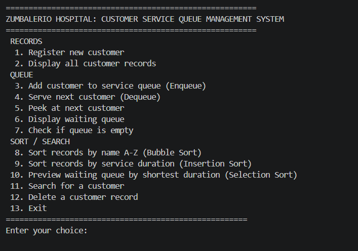

*The main menu showing all 13 options grouped into Records, Queue, and Sort/Search.*

### 2. Adding Records and Displaying Stored Records

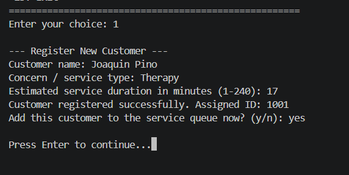

*Option 1: registering a new customer. The system assigns a unique ID and offers to add the customer to the queue.*

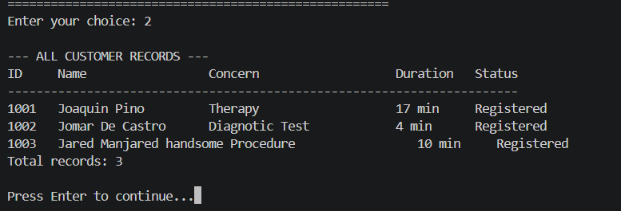

*Option 2: all stored customer records displayed in a table.*

### 3. Queue Operations

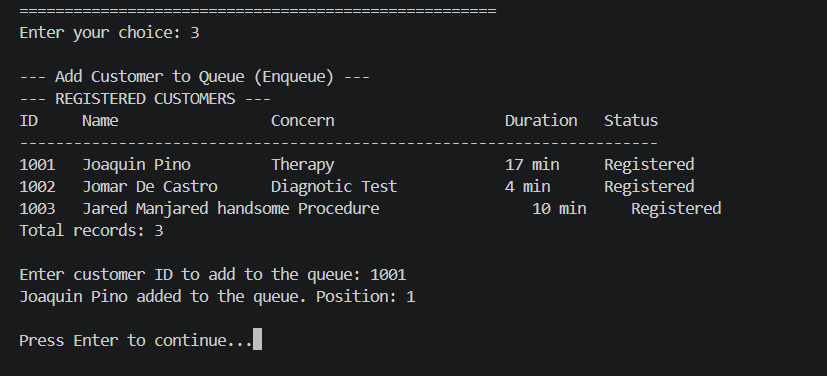

*Option 3 (Enqueue): a registered customer is added to the back of the queue and their position is shown.*

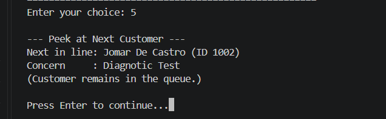

*Option 5 (Peek): the next customer is shown without being removed from the queue.*

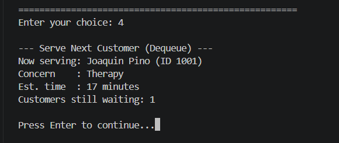

*Option 4 (Dequeue): the customer at the front is served and removed from the queue.*

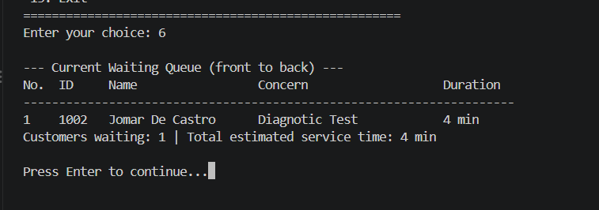

*Option 6: the waiting queue from front to back with total estimated service time.*

### 4. FIFO Behavior

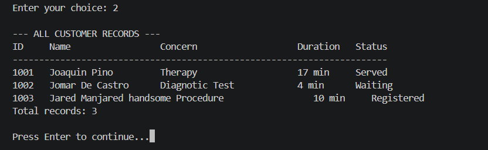

*Three customers are enqueued in order (for example A, B, C). Dequeuing three times serves them in the same order (A, B, C), showing that the first customer added is the first one processed.*

### 5. First Sorting Algorithm: Bubble Sort (by Name)

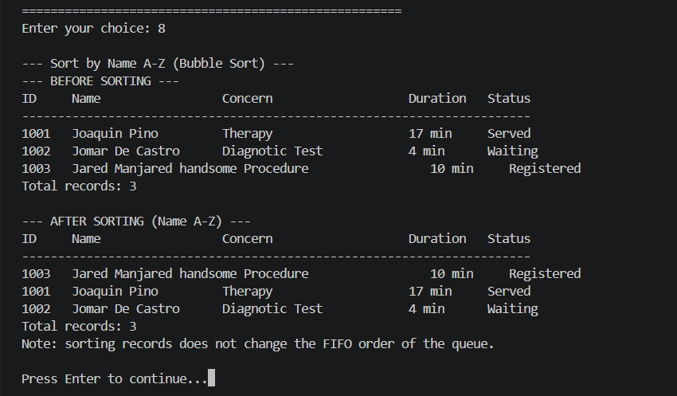

*Option 8: records shown before sorting and after sorting alphabetically (A-Z).*

### 6. Second Sorting Algorithm: Insertion Sort (by Duration)

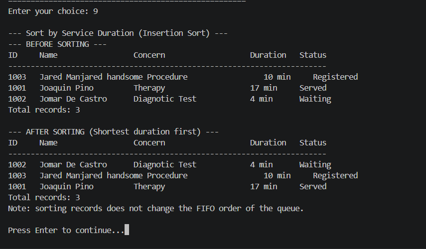

*Option 9: records shown before sorting and after sorting from shortest to longest duration.*
### 7. Additional Sorting Algorithm: Selection Sort (Queue Preview)

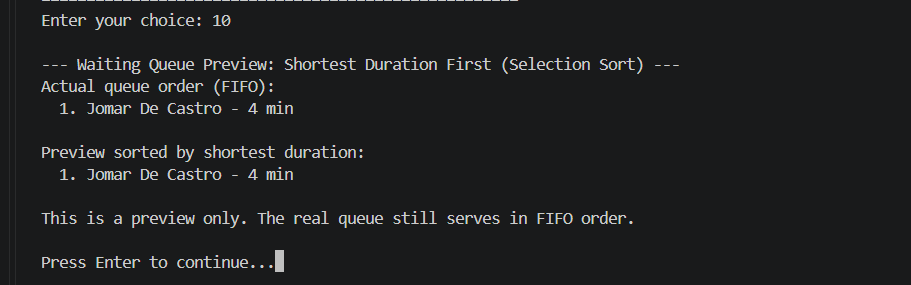

*Option 10: the actual queue order (FIFO) is shown first, 
followed by the preview sorted by shortest duration. The note at the bottom confirms the real queue is unchanged.*
### 8. Input Validation and Error Messages

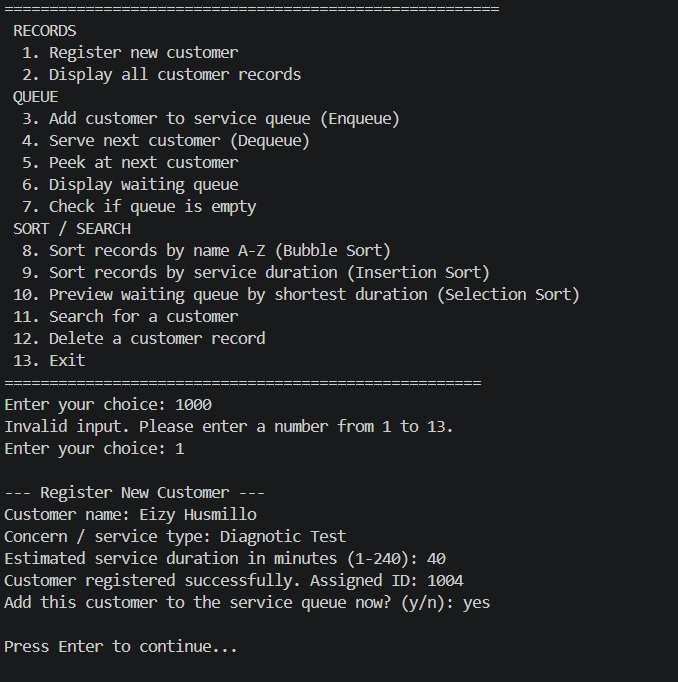

*Entering a letter or an out-of-range number at the menu displays an error and asks again.*

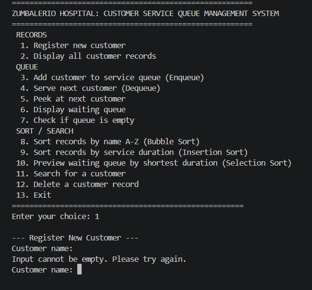

*Leaving the customer name empty shows "Input cannot be empty" and re-prompts.*

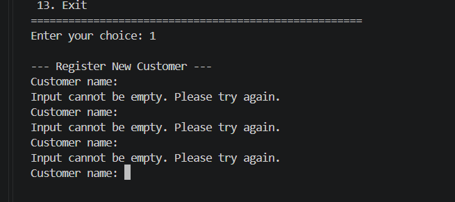


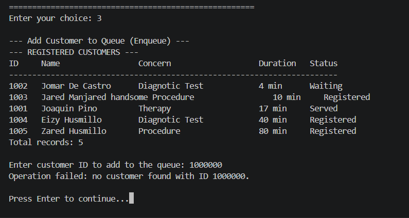


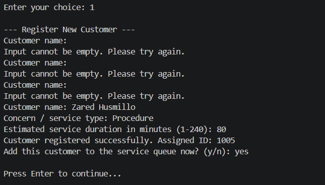

*Dequeuing from an empty queue, or enqueueing an unknown or already waiting customer, shows an appropriate error message.*

---

## Author

- **Name:** _Valerio, Kenneth The Great_
- **Course / Section:** _IT2A_

